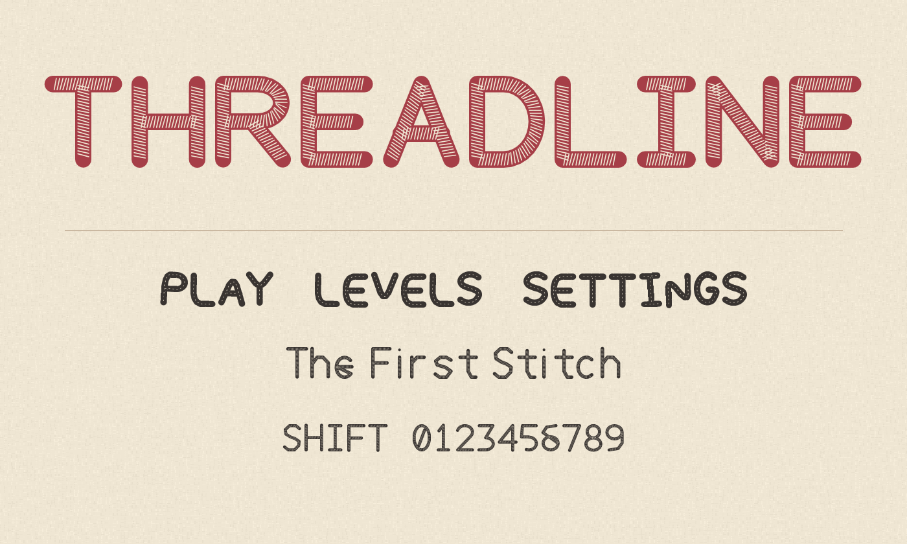

  

# Threadline

Threadline is an original family of drawn thread paths for games and cloth inspired interfaces.
It includes Running, Satin, Applique, Plain, Woven, and Chain styles.
Woven has wide strokes for titles, Chain has soft looped strokes, and Satin works for smaller labels.

Install the TTF files in `fonts/`, or use the WOFF2 exports for the web.
The [linen](specimens/phone-linen.png) and [dark](specimens/phone-night.png) phone specimens show Woven and Satin at 390 by 844 pixels.

The editable glyph paths are in `source/paths.py`.
Install the pinned packages in `requirements.txt`, then run `python3 tools/build.py`, `python3 tools/check.py`, and `python3 tools/proof.py` to rebuild and review the family.

Threadline is licensed under the [SIL Open Font License 1.1](OFL.txt).
