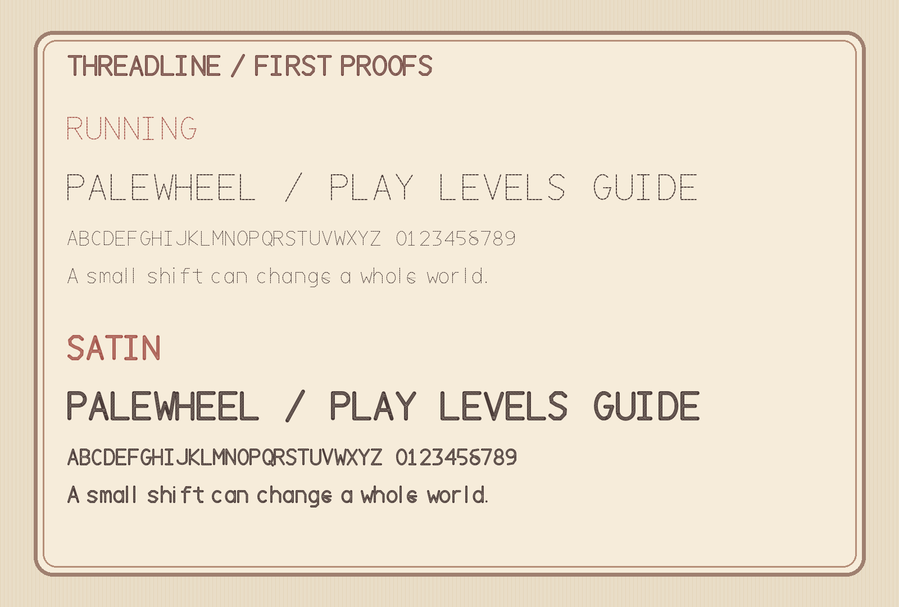

# Threadline

Threadline is an original family of type studies drawn for stitched cloth interfaces.
The first proof has two styles.
**Running** uses separated needle strokes.
**Satin** uses a broad yarn shape with angled stitch channels.

## Status

These are design proofs, version 0.1.0.
They contain the 95 printable ASCII characters and are usable for testing, but they are not ready for font galleries or Google Fonts.
The lowercase, spacing, kerning, curves, diacritics, and small-size rendering need further work.
No Google Fonts submission has been made.

## Files

- `source/paths.py` holds the original editable glyph skeletons.
- `tools/build.py` turns those drawings into scalable TTF outlines.
- `tools/proof.py` renders the visual specimen.
- `fonts/` contains the current TTF proofs.

## Build

Use Python 3.14 and install the pinned packages in `requirements.txt`.
Run `python3 tools/build.py` and `python3 tools/proof.py` from the repository root.

## License

The font source and binaries are licensed under the SIL Open Font License 1.1 in [OFL.txt](OFL.txt).
