

  

Threadline is a family of drawn thread paths for games and cloth inspired interfaces.
Its styles are Running, Satin, Applique, Plain, Woven, and Chain.
Woven suits large titles, while Satin and Plain remain clearer at smaller sizes.
Regular weights are available throughout the family, with heavier weights for Satin, Applique, Woven, and Chain.
Every font maps 352 characters, including the Google Fonts Latin Core set.

Download [TTF and WOFF2 files](https://github.com/chaosmos-studio/threadline/releases/latest).

## Specimens

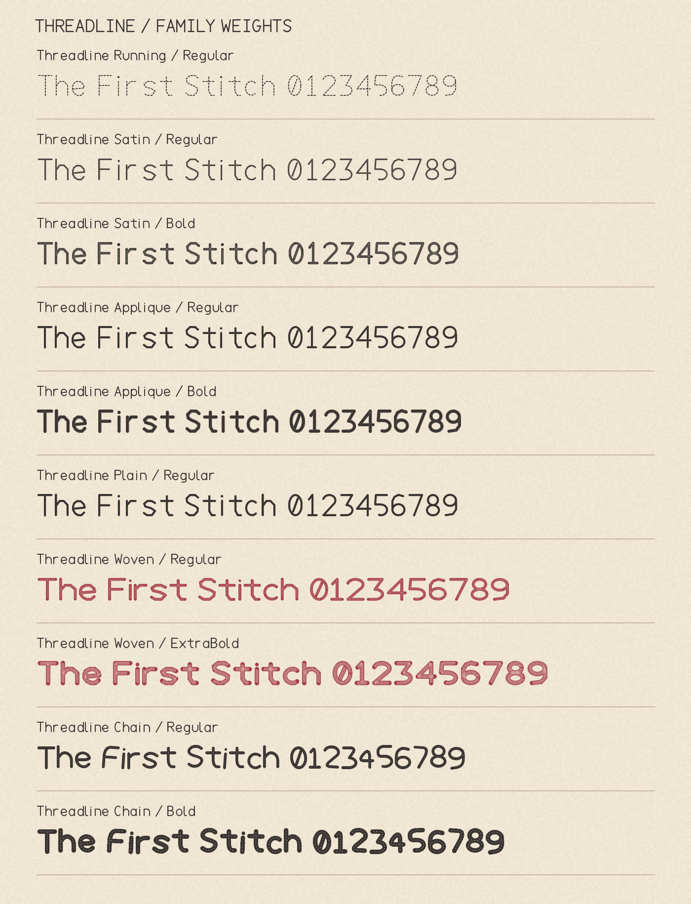

## Characters

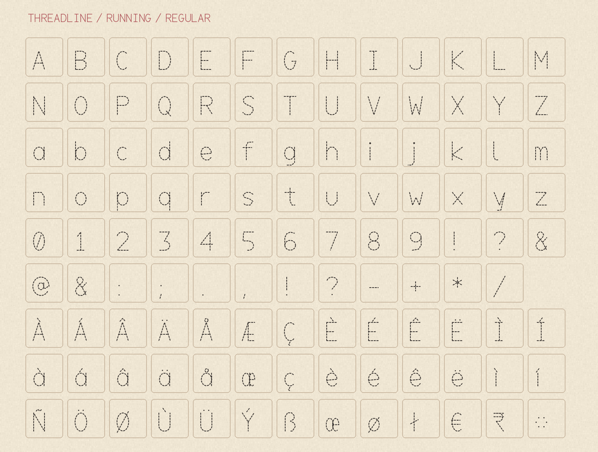

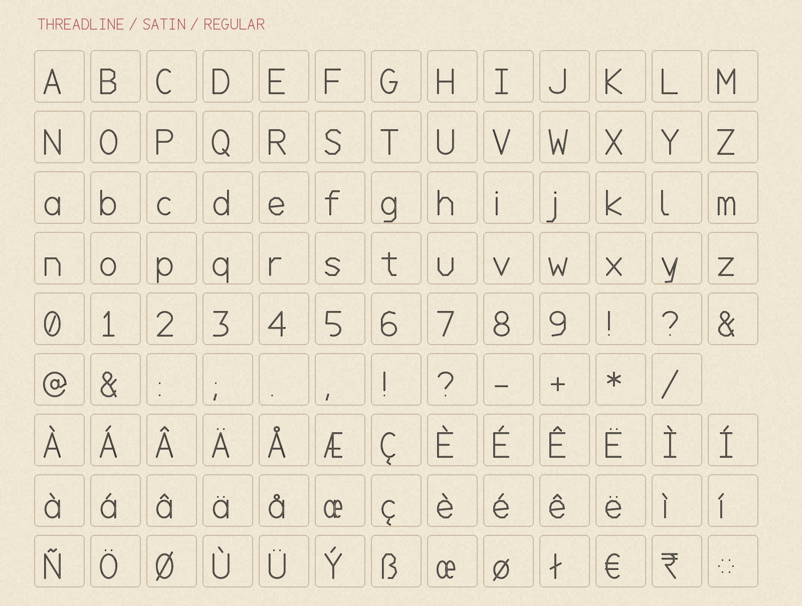

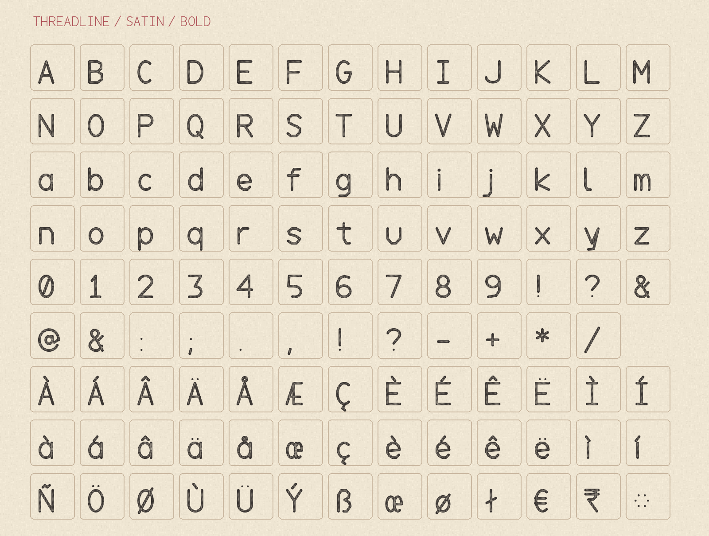

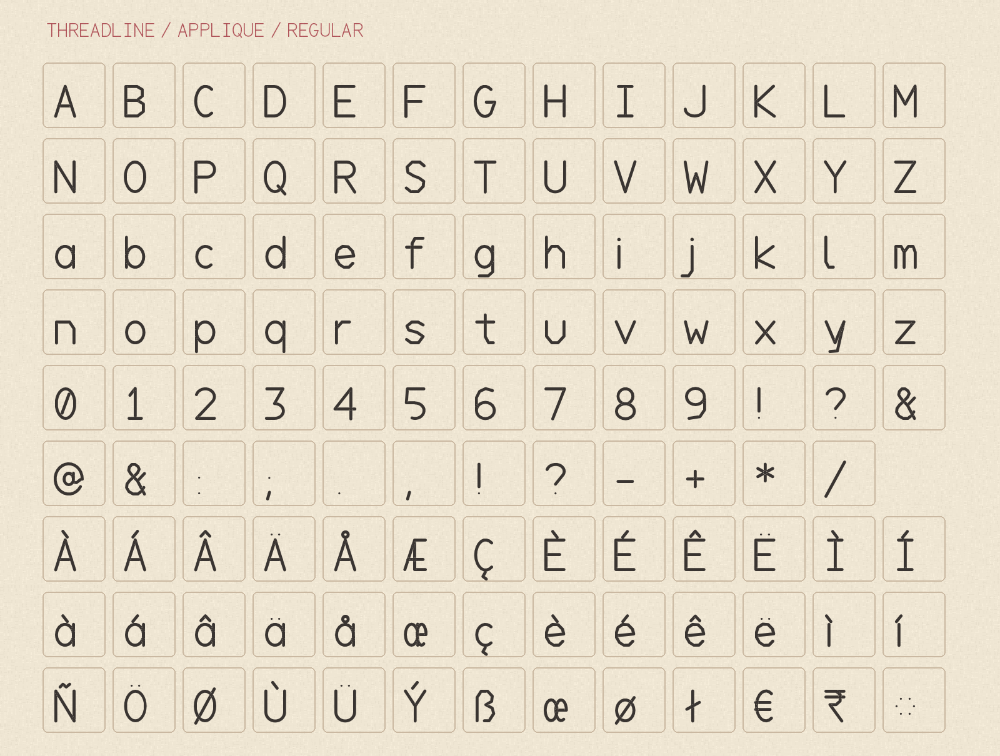

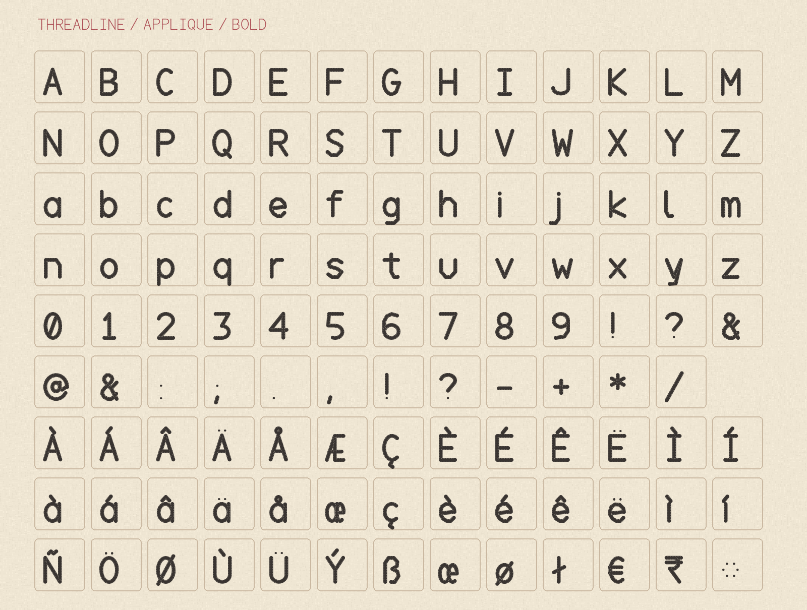

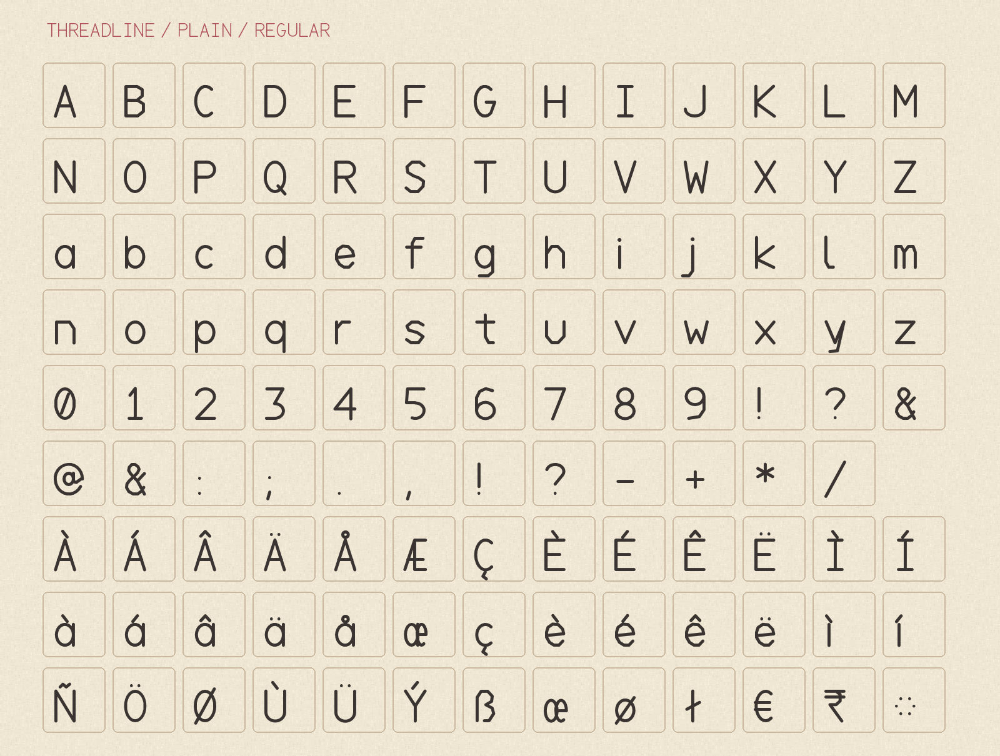

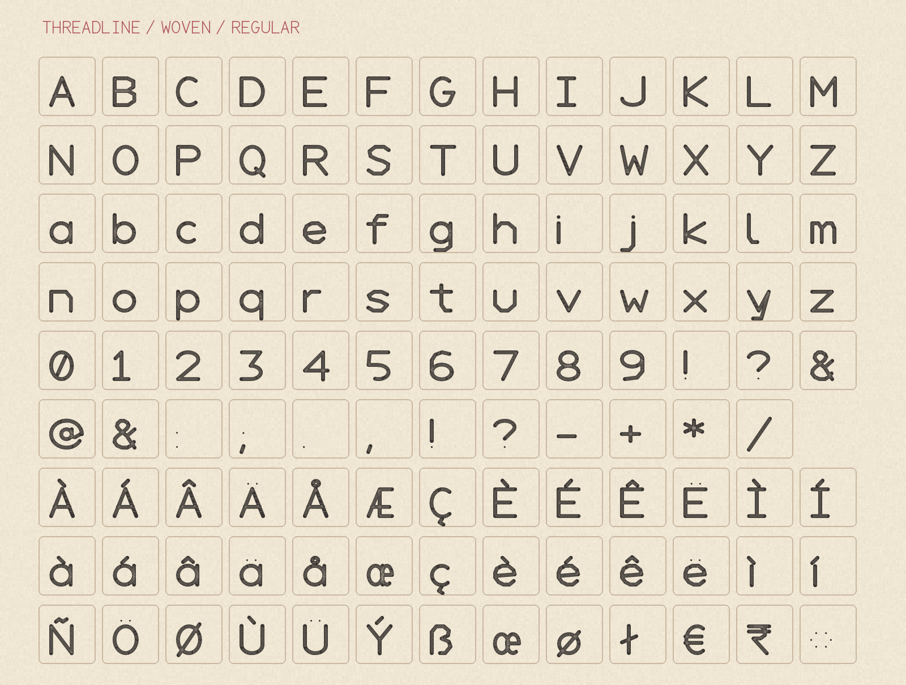

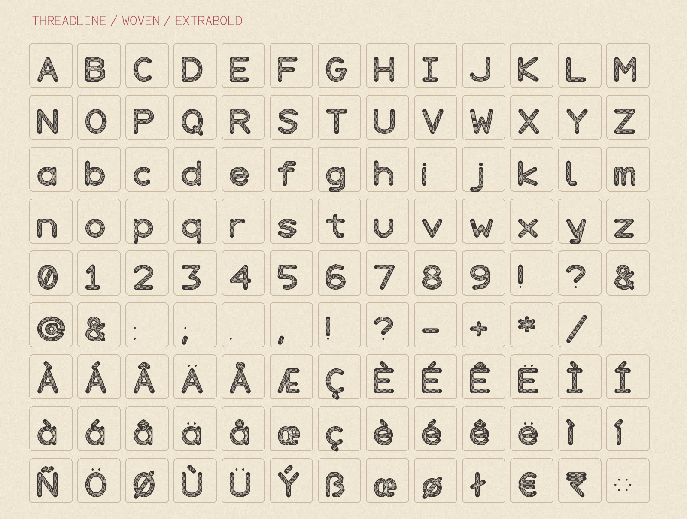

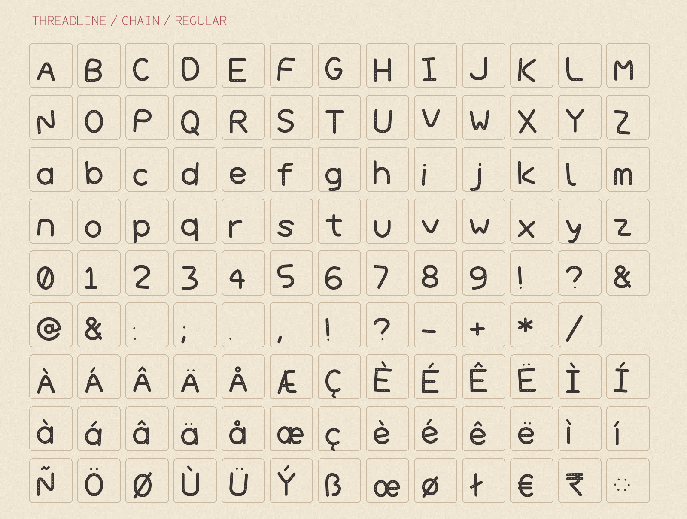

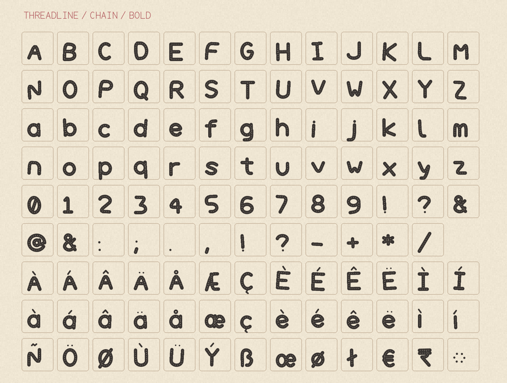

## License

Threadline is available under the [SIL Open Font License 1.1](OFL.txt).
See [AUTHORS.txt](AUTHORS.txt) for the creators.

[Build instructions](sources/README.md)
