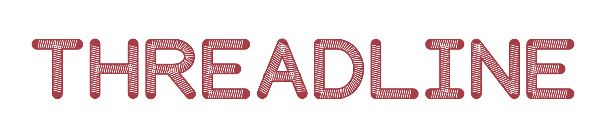
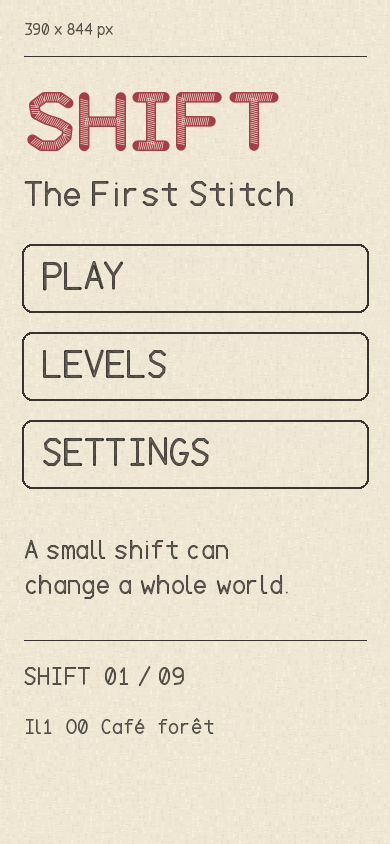
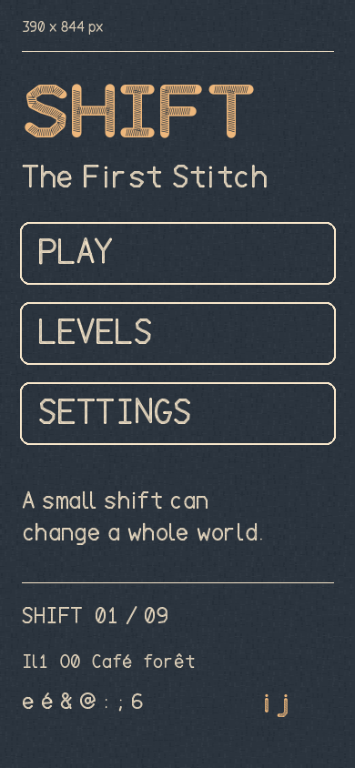
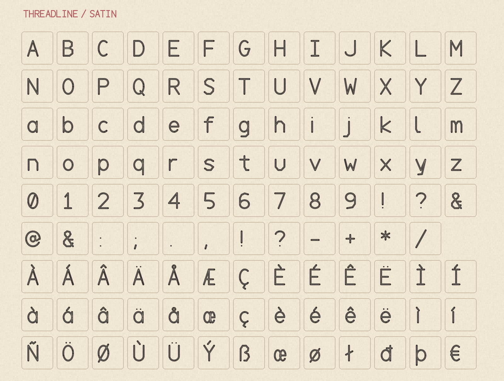
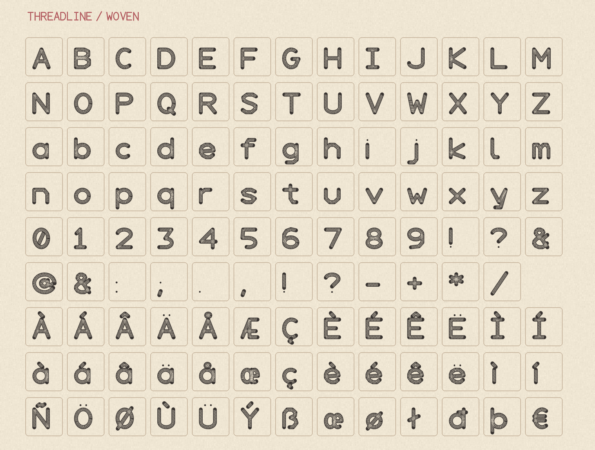
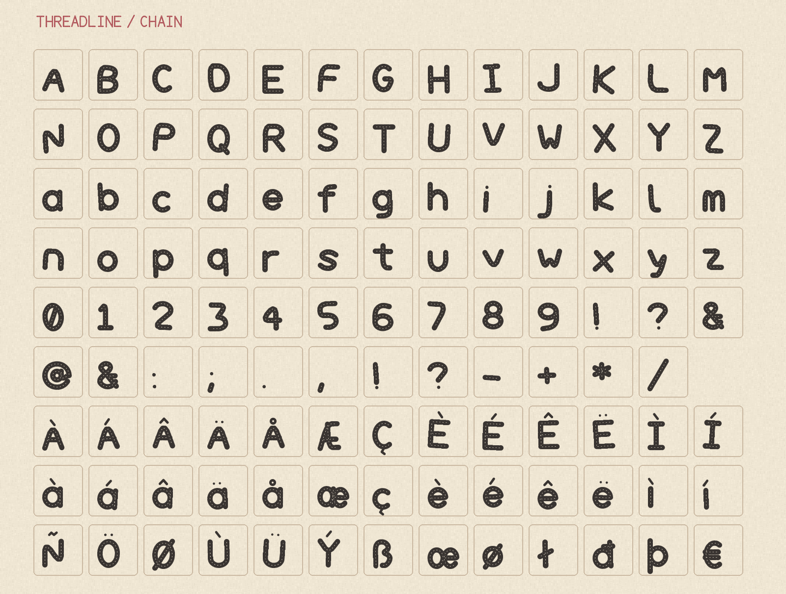

  

Threadline is a family of drawn thread paths for games and cloth inspired interfaces.
Its styles are Running, Satin, Applique, Plain, Woven, and Chain.
Woven suits large titles, while Satin and Plain remain clearer at smaller sizes.

Get the TTF and WOFF2 files from the [latest release](https://github.com/chaosmos-studio/threadline/releases/latest).

## Specimens

## License

Threadline is available under the [SIL Open Font License 1.1](OFL.txt).
