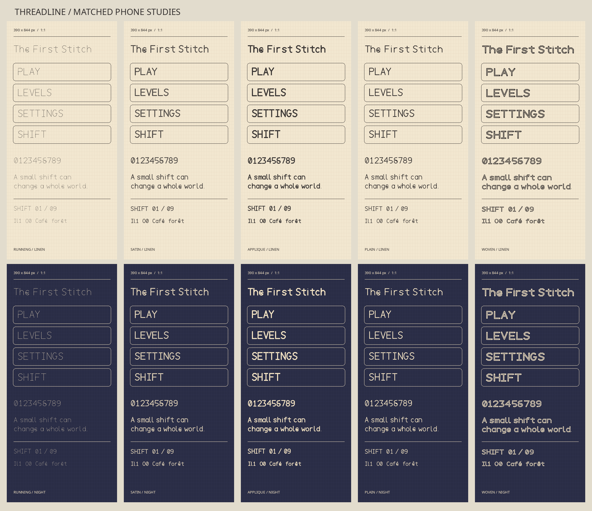

# Threadline

Threadline is an original type family drawn for stitched cloth interfaces.
Its editable centerlines define the letter shapes, thread direction, and sewn edges.
Version 0.2.0 is an installable design candidate for the game, pending review in the game itself.

## Directions

| Design | Construction | Best use |
| --- | --- | --- |
| Running | Short thread segments follow the letter paths with regular needle entries. | Large, quiet lettering |
| Satin | Broad paths contain short transverse thread channels. | Short display labels |
| Applique | Wide cut-cloth paths have fine stitch cuts along both edges. | Menu titles and level names |
| Plain | The same letter skeletons become clean, continuous strokes. | HUD, settings, and instructions |
| Woven | Extra-wide letter paths hold dense angled thread cuts inside a heavy outline. | Home menu, level names, and short calls to action |

**Recommendation:** Use Threadline Woven for the home menu, level names, and short prominent labels.
Use Threadline Plain for longer settings and instruction text.
Woven stretches the original letter paths horizontally by one quarter and gives them a much heavier thread band.
Its angled cuts follow each path and leave a strong silhouette at phone size.
The Plain style keeps the same letter skeletons for quieter text.
The `I` has crossbars, `l` has a foot, `1` has an angled head and base, and `0` has an internal slash.
Small, consistent joins let repeated letters keep the same rhythm without loose ends or decorative knots.

## Specimens

[Matched phone comparison](specimens/phone-comparison.png) shows all five styles at 390 by 844 pixels, one image pixel per screen pixel, on linen and a dark night palette.
Each style also has a [large specimen](specimens/applique-large.png) and separate 390 by 844 pixel phone images in `specimens/`.
Every direction shows PLAY, LEVELS, SETTINGS, SHIFT, "The First Stitch", 0-9, and the same mixed-case sentence.
The specimens include accent and ambiguity checks.

## Files and build

- `source/paths.py` contains the editable original glyph centerlines and accent drawings.
- `tools/build.py` converts those drawings into scalable outlines and builds five TTF and WOFF2 pairs in `fonts/`.
- `tools/proof.py` generates the matched specimen images.
- `tools/check.py` checks mapping, names, outlines, horizontal and vertical metrics, and WOFF2 decoding.
- `OFL.txt` is the SIL Open Font License 1.1 for the sources and exports.

Use Python 3.14 with the exact package versions in `requirements.txt`.
Run `python3 -m pip install -r requirements.txt`, then `python3 tools/build.py`, `python3 tools/check.py`, and `python3 tools/proof.py` from this directory.
The build can use the system `brotli` command when the pinned Python Brotli package is unavailable.
On this machine, two consecutive builds produced identical TTF and WOFF2 hashes.

All five fonts map 291 characters.
They include uppercase, lowercase, numerals, printable ASCII symbols, typographic punctuation, common currency marks, Latin-1 accents, and many extended Latin letters.
The font files have installable embedding permissions and a small GPOS kerning set for common display pairs.

## Google Fonts status

The [current Google Fonts requirements](https://googlefonts.github.io/gf-guide/requirements.html) call for GF Latin Core coverage for Latin families.
Its [production guide](https://googlefonts.github.io/gf-guide/production.html) calls for complete editable sources, an open-source one-step build, reproducibility, CI, and review.
The [current QA guide](https://googlefonts.github.io/gf-guide/qa.html) uses the Fontspector Google Fonts profile and describes FontBakery as the previous primary tool.
Threadline has not yet reached that submission gate.
It still needs a GF Latin Core audit and missing glyphs, UFO sources for this Python-first workflow, Fontspector profile results, and review in Godot, Android, browsers, and print.
No Google Fonts submission has been made.
